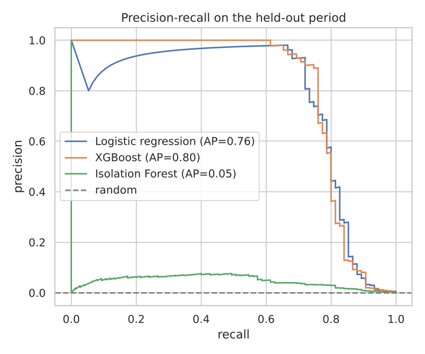
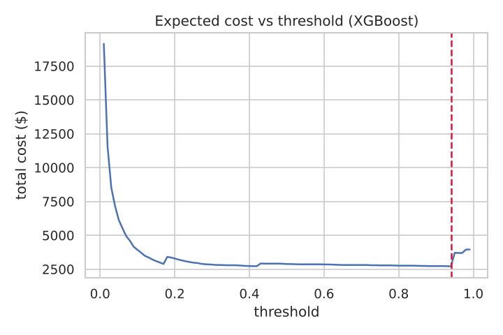
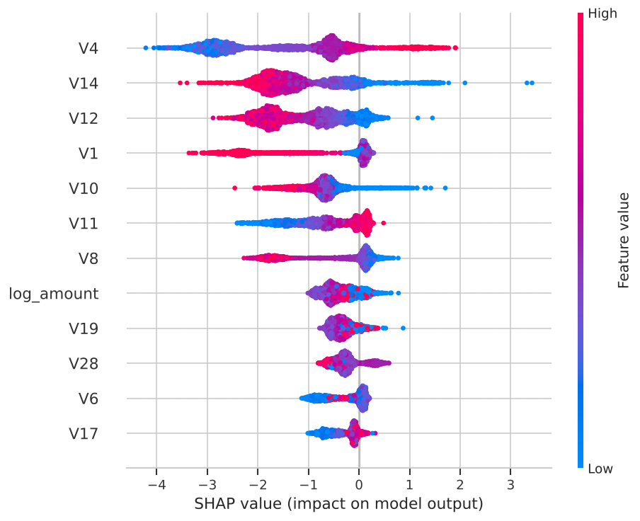

# Credit Card Fraud Detection

Detects fraudulent card transactions in a dataset where only 0.17% of transactions are fraud. Compares a supervised baseline, a gradient-boosted model and an unsupervised anomaly detector, then sets the alert threshold by expected dollar cost instead of the default 0.5.



## Data

284,807 card transactions made by European cardholders over two days in September 2013, 492 of them fraud ([ULB / Kaggle](https://www.kaggle.com/datasets/mlg-ulb/creditcardfraud)). `V1`–`V28` are PCA components of confidential fields; `Time` and `Amount` are raw. The notebook downloads a hosted copy automatically.

## Approach

- **Time-based split:** train on the first 80% of the period, test on the last 20%, so the model is always scored on transactions from after its training data
- **Features:** the 28 PCA components, log amount and hour of day
- **Models:** logistic regression with class weights, XGBoost with `scale_pos_weight`, and Isolation Forest trained without labels
- **Metric:** PR-AUC (average precision), since accuracy is 99.8% for a model that never flags anything
- **Threshold:** chosen to minimize total cost, where a missed fraud costs its amount and a false alarm costs $10 of review time
- **Explainability:** SHAP values for the XGBoost model

## Results (held-out final 20% of the period)

| Model | PR-AUC | ROC-AUC | Fraud caught in top 1% of scores |
|---|---:|---:|---:|
| Logistic regression | 0.759 | 0.987 | 86.7% |
| **XGBoost** | **0.796** | 0.986 | 86.7% |
| Isolation Forest (no labels) | 0.047 | 0.951 | 52.0% |

At the cost-optimal threshold (0.94), XGBoost catches **76% of fraud at 89% precision**. Total cost on the test period falls from $7,729 with no model to **$2,708**.



**What this means**

- XGBoost is the best primary detector.
- Isolation Forest never sees a label but still ranks half of all fraud in its top 1%. It can flag new attack patterns before labeled examples exist.
- The threshold is a business decision. The cost curve shows the trade-off so a fraud operations team can choose it.



## How to run

```bash
git clone https://github.com/mehtesham13/credit-card-fraud-detection.git
cd credit-card-fraud-detection
pip install -r requirements.txt
jupyter notebook fraud_detection.ipynb
```

The first run downloads the dataset (about 69 MB).

## Next steps

- Velocity features such as transactions per card per hour (needs card IDs, which this dataset does not include)
- Retraining on a rolling window with weekly monitoring of score drift
- Cost-sensitive training instead of only cost-based thresholding

Author: Muhammad Ehtesham · [LinkedIn](https://www.linkedin.com/in/muhammad-ehtesham-dsa)
